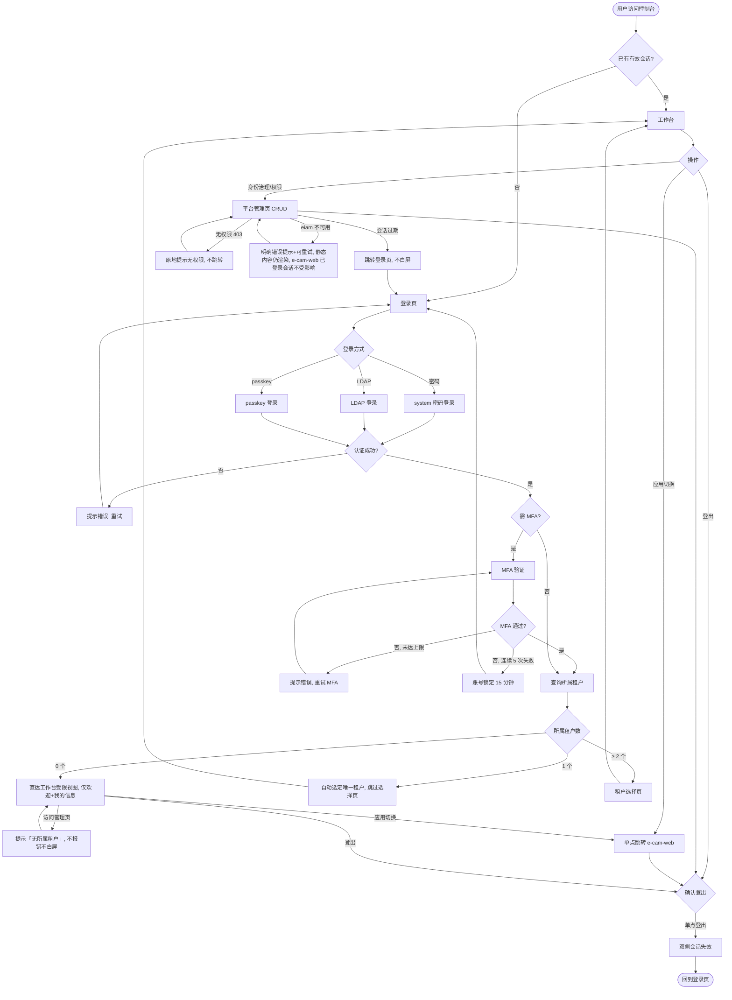

# 平台控制台 — PRD Spec

> PRD Spec: 定义「做什么」与「为什么」。

## Background

### Why (Reason)

ecmdb-web（Duke1616 的前端）下线后，平台级「统一入口 + 权限管理 + 身份治理 + 工作台」失去宿主。这些能力当前寄生在 ecmdb-web 的 `login`/`iam`/`navigation` 视图里（直调 eiam）。e-cam-web 是云管业务前端（其 `views/iam` 是**云 IAM**——云账号子账号/用户组/策略同步），不应承载平台治理。eiam 决定保留，但没有自己的前端。现有 29 个 proposals 无任何门户/控制台/身份治理相关条目。若不动，平台身份/权限管理 UI 随 ecmdb-web 下线直接断供，且继续依赖他人前端，违背「100% 可控」目标。

### What (Target)

新建一个独立的**纯前端**「平台控制台」子项目：直调 eiam 已有 API，复用 eiam 写入的共享 Redis session，承载 登录/登出 + 统一导航、身份治理、权限管理、工作台（纯 eiam 侧），与 e-cam-web 单点登录互通；并把 e-cam-web 里孤立的 `platform/users` 页面迁出。除 eiam 外**零新增后端**。

### Who (Users)

| 角色 | 职责 | 典型操作 |
|------|------|---------|
| 平台管理员 | 全局治理 | 管所有租户/用户/角色/授权/身份源，配置登录方式 |
| 租户管理员 | 租户内治理 | 管本租户用户/角色/授权（可绑定已有策略，不可增删策略定义），不可超出租户边界 |
| 普通用户 | 消费 | 登录、看工作台、切应用到 e-cam-web |
| 只读/审计角色 | 审计 | 只读查看用户/组织/身份源/角色/授权页面（不含租户与策略管理），不可增删改 |

## Goals

| Goal | Metric | Notes |
|------|--------|-------|
| 平台身份/权限/工作台能力接入 | Phase 0 parity 覆盖率 100%；覆盖率 = 已覆盖项 ÷（总项数 − 「放弃」项），每项「放弃」须业务 owner 书面确认并登记理由与 UI 降级 | 清单宿主 `parity-checklist.md` |
| 登录/SSO 闭环可用 | 验收场景清单（正+负+边界 ≥ 24 条，映射自 E1–E12 与各 UF）真实浏览器（Playwright/浏览器 MCP）验证 100% 通过 | 清单宿主 `acceptance.md`；含双向单点登出 |
| 零后端 | 除 eiam 外不新增任何后端服务（部署清单核验 = 0） | 纯前端 |
| 性能达标 | 首屏静态资源 gzip ≤ 300 KB；同域内网 LCP ≤ 2.5s（二次 ≤ 1s） | 实测报告 |
| 可控交付 | v1 开发 5.5–6.5 人周，里程碑 M1–M4 | 含 Phase 0 约 1 周 |

### Milestones（M1–M4 定义）

| 里程碑 | 范围 | 出口判据 |
|--------|------|---------|
| Phase 0（前置，约 1 周，计入总工期） | 端点差集盘点、认证链路核查、服务端授权核查、`platform/users` 能力映射、eiam 契约基线冻结 | `parity-checklist.md` 逐项 evidence 签收，缺口处置决策完成 |
| M1 | 项目脚手架 + 登录/登出/会话（UF-1）+ e-cam-web 401 跳转目标切换（Related Change #2） | 登录正/负/边界场景（E1/E2/E8/E9）真实浏览器通过 |
| M2 | 租户分流与租户选择、工作台、应用切换（UF-2/UF-3/UF-11） | E3/E4/E5 通过；单点跳转与双侧登出（Story 6）通过 |
| M3 | 身份治理四页（UF-4/UF-5/UF-6/UF-7） | 对应 CRUD 场景与 E7/E10/E11 通过 |
| M4 | 权限管理三页（UF-8/UF-9/UF-10）+ `platform/users` 迁出收尾（Related Change #1） | `acceptance.md` 全部场景通过；Related Change #1 前置门双签完成 |

### 验收清单约束（acceptance.md 完成形态）

- 映射矩阵：E1–E12 每条至少 1 个验收场景，UF-1–UF-11 每个 UF 至少 1 条；每个场景标注来源（E#/UF#）与类型（正向/负向/边界）
- 负向占比：负向 + 边界场景合计 ≥ 总数的 1/3（按 ≥ 24 条计即 ≥ 8 条）
- 产出阶段与 owner：Phase 0 产出矩阵骨架（场景项 + 来源映射），M1–M4 随里程碑补齐对应场景；前端 owner + 测试 owner 双署，涉 eiam 断言须 eiam owner 会签
- 完成形态：每条场景附真实浏览器执行证据（Playwright 用例链接或浏览器 MCP 会话记录）；全部通过是 Related Change #1 迁移前置门的输入之一

## Scope

### In Scope
- [ ] 登录/登出（eiam system/LDAP/passkey/MFA 流程）+ 统一导航 + 应用切换
- [ ] 身份治理：平台用户/组织/租户/身份源管理
- [ ] 权限管理：角色/授权/策略管理
- [ ] 工作台（纯 eiam 侧：欢迎 + 我的信息 + 应用快捷导航）
- [ ] 从 e-cam-web 迁出平台身份 UI（`platform/users`），消除双处维护
- [ ] e-cam-web 会话过期/401 跳转目标切换为控制台登录页
- [ ] Phase 0：端点差集盘点 + 认证链路事实核查（cookie/session 兼容矩阵）+ 服务端授权核查（CRUD 端点逐项确认 eiam 强制鉴权）+ 缺口处置决策门；产出 `parity-checklist.md`（逐项 evidence 签收）
- [ ] 产出「下线就绪清单」（ecmdb-web 下线判据，执行下线本身不属本提案）

### Out of Scope
- 工作台跨服务聚合（云资产/告警/证书概览）→ 后续迭代
- eiam 本身替换（保留，含其 SDK/服务）
- 后端改造：反转 ecmdb 决策 / internal/cmdb 扶正 → 另立提案
- 工单（ticket）/ 变更（change）→ **有意退役**（近 90 天使用数据 + 使用方确认后不重建；活跃使用需 owner 签字，由下线提案在 ecmdb-web 在线窗口内执行）
- 自建 BFF / 聚合网关后端
- 用户自助改密 / passkey 设备丢失自助重绑 → v1 控制台不提供自助流程：改密唯一路径 = 管理员重置（E1）；passkey 重绑唯一路径 = 管理员撤销原绑定后重新发起注册引导（UF-4）；eiam 侧既有自助端点如存在，其 UI 承载不属本提案
- 云管业务演进（e-cam-web 保持现职，仅边界清理与 401 切换改动）
- 共享组件库 / 设计系统沉淀 → 另立提案（v1 仅「同组件库锁同版本 + token 共享文件引用」）

## Flow Description

### Business Flow Description

1. 用户访问控制台，若有有效会话直接进工作台，否则进登录页。
2. 登录页按 eiam 支持的方式（密码/LDAP/passkey，必要时 MFA）完成认证；MFA 失败可重试（连续 5 次锁定 15 分钟）；认证成功后写回 eiam 共享 Redis session。
3. 登录后查询所属租户并分流：0 个 → 直达工作台受限视图（仅欢迎+我的信息；访问管理页提示「无所属租户」）；1 个 → 自动选定唯一租户直达工作台；≥ 2 个 → 进入租户选择页（tenant_id 写入共享 session 口径以 Phase 0 事实核查为准）。平台管理员豁免零租户限制（E3）。
4. 工作台展示欢迎 + 我的信息 + 应用快捷导航；顶部导航可切到身份治理/权限管理各页面。
5. 管理员对用户/组织/租户/身份源/角色/授权/策略做增删改查（直调 eiam）。
6. 用户经「应用切换」单点跳转 e-cam-web，共享会话、不重复登录。
7. 任一侧（控制台/e-cam-web；过渡期含 ecmdb-web）登出即销毁共享 session，其余应用/标签页在下一次请求时 401 收敛并跳回控制台登录页（不做实时广播）。过渡期三方语义：权威登录入口 = 控制台 `/login`，ecmdb-web 登录入口重定向至此（Phase 0 核查现状）。
8. 异常分流：会话过期 → 跳转控制台登录页；无权限（403）→ 原地提示、不跳转登录页；eiam 不可用 → 静态资源仍可加载、明确错误提示、e-cam-web 已登录会话不受影响。

### Business Flow Diagram

### Data Flow Description

| Data Flow ID | Source System | Target System | Data Content | Transport | Frequency | Format | Notes |
|-----------|--------|----------|----------|----------|------|------|------|
| DF001 | 平台控制台 | eiam | 登录请求（system/LDAP/passkey/MFA） | REST API | 按操作 | JSON | 复用 eiam 现有端点，不自建 |
| DF002 | eiam | Redis | 会话写入（JWT claims：uid/username/tenant_id） | 共享存储 | 登录时 | session | e-cam-service 认证中间件同源读取；tenant_id 写入断言（是否始终写入、零租户用户取值）待 Phase 0 核查 |
| DF003 | 平台控制台 | eiam | 用户/角色/租户/授权/策略 CRUD | REST API | 按操作 | JSON | 直调 eiam，无自建后端 |
| DF004 | e-cam-web | eiam/session | 会话校验、过期/401 | REST API + 共享 session | 每次请求 | session | 401 跳转目标改为控制台登录页 |

## Functional Specs

> UI 功能规格详见 [prd-ui-functions.md](./prd-ui-functions.md)。

### Related Changes

| # | Project | Module | Change Point | Updated Logic |
|------|----------|----------|------------|----------------|
| 1 | e-cam-web | views/platform | 移出 `platform/users` | 迁至控制台；前置门 = `parity-checklist.md` 逐项覆盖且逐项附 evidence（截图/接口响应/用例链接），平台管理员 + eiam owner 双签；附引用盘点/回归/回退 |
| 2 | e-cam-web | 请求层 | 会话过期/401 跳转目标 | 由 ecmdb-web login 改为控制台登录页 |
| 3 | eiam | （外部，保留） | 端点差集缺口 | Phase 0 决策门：缺口三类处置（UI 降级仅查看类 / 扩端点需显式决策 / 放弃需业务确认） |

**Related Change #1 前置门补充——能力映射**：Phase 0 须产出 `platform/users` 现有能力清单（功能点 × 当前实现方式 × 依赖的 eiam 端点），并与控制台 UF 逐项映射，每个能力项标注落点（三选一）：映射到 UF-4 对应项 / 有意不迁移（登记理由）/ eiam 缺端点进入缺口处置。映射表并入 `parity-checklist.md` 作为双签材料；未经映射的能力项不得标记「已覆盖」。

## Edge & Negative Scenarios

| # | Scenario | Expected Behavior |
|---|----------|-------------------|
| E1 | 密码重置 | 管理员重置 → 生成一次性初始密码（展示一次）；该用户首次登录强制改密（v1 无自助改密路径，归属见 Out of Scope） |
| E2 | 账号锁定 | 连续 5 次密码错误锁定 15 分钟；登录页提示剩余解锁时间，可等待或改用其他已启用方式 |
| E3 | 零租户用户登录 | 普通用户/租户管理员零租户：认证通过但不进租户选择，仅见工作台+我的信息；访问管理页提示「无所属租户」，不报错不白屏。平台管理员豁免本规则：职责跨租户、不依赖所属租户，零所属租户仍可访问全部管理页 |
| E4 | 单租户用户 | 跳过租户选择页，自动选定唯一所属租户直达工作台 |
| E5 | 多租户切换 | 经顶部租户切换器重选，tenant_id 写回 session 并刷新数据 |
| E6 | 并发编辑 | 同一对象并发编辑：后提交者生效；若 eiam 返回 409 版本冲突（Phase 0 核查是否支持）则提示刷新后重试 |
| E7 | 分页边界 | 超界页码回落最后一页；空页显示空状态；删除末页唯一记录后回退上一页 |
| E8 | passkey 浏览器不支持 | WebAuthn 不可用：隐藏 passkey 入口，提示改用密码/LDAP，无 JS 报错 |
| E9 | MFA 上限 | MFA 连续失败 5 次锁定 15 分钟（与 E2 同口径），UI 提示剩余时间 |
| E10 | 用户名长度/字符集 | 3–32 字符，`^[a-z][a-z0-9_-]{2,31}$`；前端即时拦截，唯一性由 eiam 校验 |
| E11 | 依赖删除失败 | 删除被依赖对象（下属组织/关联用户/用户绑定）被拒：弹窗列出阻断计数，确认按钮置灰（见 UF-5/UF-8） |
| E12 | eiam 不可用 | 管理页错误态可重试；工作台静态内容仍渲染；e-cam-web 已登录会话不受影响 |

## Other Notes

<!-- Override: Security review enabled by signal "认证/授权/权限/token" -->

### Performance Requirements
- 首屏静态资源 gzip ≤ 300 KB；同域内网 LCP ≤ 2.5s（二次访问 ≤ 1s）
- 纯静态前端站，可 CDN 加速（**但须与 e-cam-web/eiam 同登录域**，跨域 CDN 直调 eiam 不支持）

### Data Requirements
- 租户选择语义（tenant_id 存放位置、跳转上下文）以 Phase 0 事实核查为准，核查前按「错租户数据」为最高优先风险对待
- 过渡期三方（含 ecmdb-web）会话与登出语义见 Business Flow #7
- 平台管理操作审计由 eiam 承接（纳入 Phase 0 parity 清单逐项核对）
- eiam API 契约基线：Phase 0 冻结本控制台依赖的 eiam 端点快照（路径/方法/鉴权要求/关键字段）登记入 `parity-checklist.md` 作为契约基线；eiam 侧变更基线内任一端点（含字段增删、语义调整）须提前 ≥ 5 个工作日书面通知并附影响评估，未经评估的变更不得发布；发布后发现的未通知变更按缺口处置登记并触发受影响场景回归

### Monitoring Requirements
- 控制台探活健康检查（/console 探活）接入告警，与 e-cam-web 同运维面
- 上线前回切开关演练（10 分钟内可回切）

### Security Requirements
- 登录页安全面：CSP / X-Frame-Options / HSTS 由 nginx 注入，CSRF 归属 eiam，零第三方脚本
- 认证链路兼容矩阵（cookie 名/属性、Origin/Referer 校验、session 结构、tenant_id 来源）经 eiam 后端 owner 书面会签
- 服务端强制授权：eiam 对所有 CRUD 端点做服务端权限校验，前端菜单裁剪仅为体验层、非安全边界；Phase 0 核查矩阵逐端点确认，缺失端点进入缺口处置
- 好处传输加密/存储加密沿用 eiam 现状；登录与数据操作明确错误提示、不白屏

---

## Quality Checklist

> 每项指向可核验证据，不采用自评勾选。

- 标题与范围一致 → In Scope / Out of Scope
- Background 三要素 → Why / What / Who
- Goals 可量化、分母明确 → Goals 表（`acceptance.md`、`parity-checklist.md`）
- 流程含异常分支 → Business Flow Diagram（MFA 上限、租户 0/1/多分流、403/过期/eiam 不可用分流）
- UI 规格完整 → prd-ui-functions.md（UF-11、字段级校验、凭据发放）
- AC 可测 → prd-user-stories.md（时限/403 原地/逐请求判定）
- 正+负+边界场景 → E1–E12
- 迁移前置门证据 → Related Changes #1（evidence 双签）
- NFR → 性能/数据/监控/安全（含服务端强制授权）