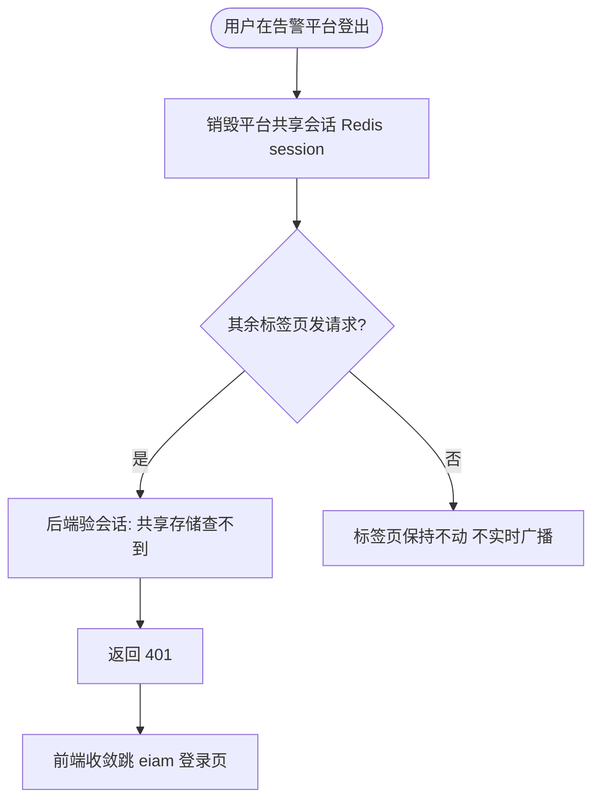
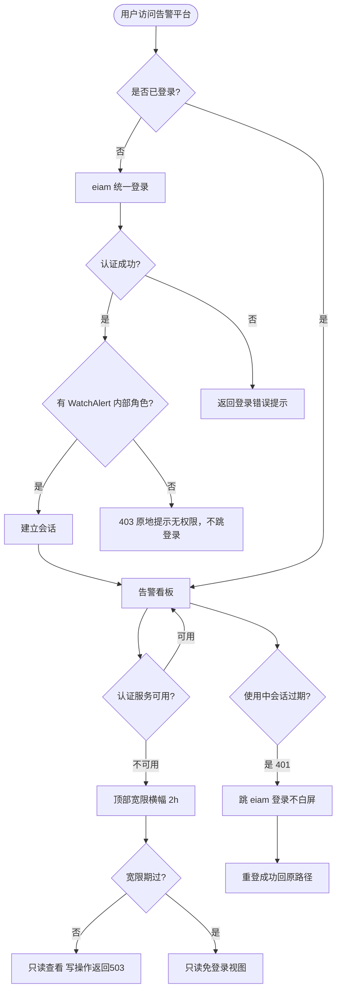
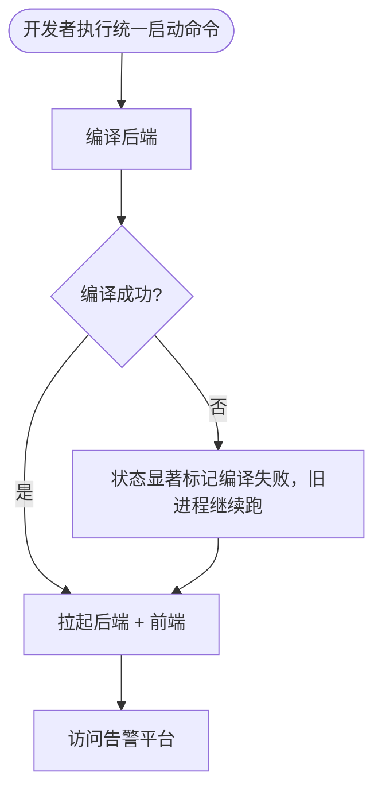
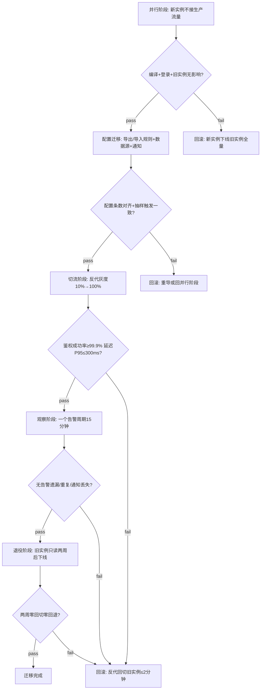

# WatchAlert 作为子项目并入运维平台（含 eiam 统一鉴权） — PRD Spec

> PRD Spec: 定义「做什么」与「为什么」。上游提案见 `docs/proposals/watchalert-subproject-integration/proposal.md`（已通过 900/1000 评估）。

## Background

### Why (Reason)

告警平台 WatchAlert 目前以「独立目录 + 独立进程 + 反代」形态游离于运维平台 workspace 之外：源码不在 workspace 内、未被平台的统一编排与质量门禁纳入、启动需手动两步；且登录仍是 WatchAlert 自身的本地账号，与平台的统一身份（eiam）割裂。运维用户要维护两套账号，安全审计与账号治理无法统一。

### What (Target)

把 WatchAlert 作为运维平台的一个**子项目**纳入统一管理（源码进 workspace、纳入平台一键启动与统一质量门禁），并把**登录统一到 eiam**——用户用平台账号登录告警平台，不再有 WatchAlert 独立账号；WatchAlert 自身的本地登录入口移除。

### Who (Users)

| 角色 | 说明 | 备注 |
|------|------|------|
| 运维/值班工程师 | 日常登录查看告警、处理故障中心、确认/静默告警 | 主要使用者 |
| 告警平台管理员 | 配置告警规则、数据源、通知渠道 | 沿用 WatchAlert 内部角色 |
| 平台开发者 | 本地一键启动/编译/测试告警子系统 | 通过平台统一命令操作 |

> 授权边界（已确认）：**eiam 只负责认证（你是谁）**；登录后能干什么（看告警/配置规则/管通知）仍由 WatchAlert 内部 admin/user 角色决定，不随 eiam 角色/组织映射。
>
> 角色获得机制（已确认）：eiam 用户登录后，WatchAlert 后端以 eiam 返回的用户唯一标识匹配预置角色表（`watchalert_role_binding`：eiam_uid → admin/user），由告警平台管理员在配置迁移时预置。无匹配记录的用户走 403 分支（见主流程 1）。不采用首登自动分配或 eiam claim 映射，避免越权默认开口。
>
> 非法角色值处理：`watchalert_role_binding` 中 role 字段为 null、空串或非 admin/user 值时，一律视为无有效角色，走 403 分支（与无匹配记录同口径），不默认放行。
>
> 绑定管理接口：管理员通过 `POST /api/watchalert/role-bindings`（单条/批量 JSON Body：`[{eiam_uid, role}]`）预置绑定，`DELETE /api/watchalert/role-bindings/{eiam_uid}` 移除绑定，`GET /api/watchalert/role-bindings` 列出全部绑定（分页）。配置迁移时支持批量导入（JSON 文件，格式同批量接口 Body）。

<!-- Override: Security Review enabled by signal "认证/token" -->
<!-- Override: Performance Baseline enabled by signal "延迟" -->

## Goals

| Goal | Metric | Notes |
|------|--------|-------|
| 账号统一 | 运维用户登录告警平台不再需要 WatchAlert 独立账号，100% 走 eiam | 消除双账号，审计归平台 |
| 一键启动 | 开发者启动告警子系统从「手动两步」降为一条命令，启动耗时 ≤ 编译 + 30 秒 | 符合平台其它子项目体验 |
| 质量门禁覆盖 | 告警子系统的编译/格式/静态检查/单元测试纳入平台统一门禁，单元测试覆盖率 ≥ 80% | 覆盖当前缺失 |
| 本地登录后门清零 | 旧用户名/密码直接请求已移除登录接口返回 404，不得签发 token | 安全硬指标；401=未认证，已移除端点统一返回 404 |
| 上游贡献不中断 | 迁入后每季度至少 1 个通用修复 PR 合入上游 master 且上游 CI 全绿 | 防止「死 fork」；可测指标 |

## Scope

### In Scope
- [ ] 告警子系统源码纳入 workspace 统一管理（作为独立子项目，保留完整提交历史与向上游贡献的通道）
- [ ] 纳入平台统一启动编排：一键启动后端 + 前端，状态/日志可观测
- [ ] 纳入平台统一质量门禁：编译/格式化/静态检查/单元测试可触发
- [ ] 登录统一到 eiam（认证委托），移除本地登录入口（后端 handler + 签名密钥 + 前端入口）
- [ ] eiam 用户 → WatchAlert 内部角色预置绑定（`watchalert_role_binding`，管理员配置迁移时预置）
- [ ] eiam 不可用时的降级：已登录用户在宽限窗口（2 小时）内继续访问，过期后只读免登录
- [ ] 生产反代入口调整，开发态直接由编排拉起
- [ ] 迁移切流：并行运行、配置迁移、切流、旧实例退役（含回滚触发/步骤/数据一致性校验）
- [ ] 单点登出：登出销毁共享会话，其余标签页下次请求 401 收敛（BIZ-auth-005）
- [ ] 会话过期承接：使用中过期跳登录不白屏、重登后回原操作路径（BIZ-auth-008）
- [ ] 作废旧接入决策，新增子项目接入决策记录

### Out of Scope
- 告警历史事件/规则的历史数据迁移（仅迁移配置，不迁历史事件）
- 前端页面嵌入门户控制台布局（告警保持独立前端入口）
- eiam 功能性/能力增强（仅允许为下游鉴权所需的最小改动）
- 权限/角色随 eiam 同步（仅统一认证，授权留在 WatchAlert 内部）

## Flow Description

### Business Flow Description

**主流程 1 —— 运维用户登录（SSO）：**
用户访问告警平台 → 系统检测未登录 → 跳转到 eiam 登录 → 用户用平台账号（或其背后的身份源）登录 → eiam 认证成功后回跳 → 系统建立会话并据用户身份签发/匹配 WatchAlert 内部角色 → 进入告警看板。若认证通过但该用户无 WatchAlert 内部角色（admin/user），返回 403 原地提示「无访问权限，请联系管理员配置角色」，保持当前页不跳登录页（BIZ-auth-003）。

**会话过期流程（BIZ-auth-008）：**
用户使用中会话过期 → 下次请求后端返回 401 → 前端跳转 eiam 登录页（不白屏、不无限 loading）→ 用户重登成功后回跳原操作路径（路径经白名单校验，见 UF-1 回跳地址规则）。

**单点登出流程（BIZ-auth-005）：**
用户在告警平台登出 → 销毁共享会话（与平台其余应用同口径）→ 其余标签页下次请求 401 收敛跳登录页，不做实时广播。WatchAlert 不自建独立会话存储，复用平台共享会话。

**主流程 2 —— 平台开发者启动：**
开发者执行统一启动命令 → 系统编译后端（失败则显著标记，旧进程继续跑）→ 拉起后端与前端 → 状态/日志可查 → 开发者访问告警平台开始工作。

**主流程 3 —— 迁移切流：**
阶段门控（每阶段须 pass 方可进入下一阶段，任一 fail 触发回滚分支）：

- **并行阶段（新实例不接生产流量）**：新实例接入 workspace 并一键启动；pass 标准 = 后端编译通过 + eiam 登录成功 + 旧实例告警不受影响；fail = 回到迁移前状态（新实例下线，旧实例全量承载）。
- **配置迁移阶段**：导出旧实例告警规则/数据源/通知配置，导入新实例；pass 标准 = 配置条数对齐（旧=N，新=N，diff=0）且抽样规则触发验证一致；fail = 重导或回滚至并行阶段。
- **切流阶段（反代指向新实例）**：反代灰度切流，先 10% 流量观察 15 分钟无 5xx/鉴权失败激增，再 100% 切流；pass 标准 = 切流后鉴权成功率 ≥ 99.9%、告警延迟 P95 ≤ 300ms。
- **观察阶段（一个告警周期 = 15 分钟，覆盖一轮告警评估→通知全链路）**：观察一个完整告警周期无告警遗漏/重复/通知丢失；fail = 反代回切旧实例（≤ 2 分钟完成），数据一致性靠旧实例仍为主源保证。
- **退役阶段**：旧实例保留只读两周后下线；pass 标准 = 两周内零回切、零配置回退需求。

**回滚触发**：切流后任一阶段 fail 或监控告警（鉴权成功率 < 99%、5xx 率 > 1%）→ 反代回切旧实例（≤ 2 分钟），新实例转为只读排查，旧实例继续承接生产，配置以旧实例为准。**回滚失败兜底**：若反代回切本身失败（反代控制面不可达或回切超 > 2 分钟），执行手动 DNS 切换将流量指回旧实例 VIP；切换期间双实例并存且均设只读模式（写操作统一 503），避免双写数据不一致；DNS 切换完成后人工确认旧实例全量承载再解除只读。

**异常流程 —— eiam 不可用：**
已登录用户 → 页面顶部出现「鉴权暂不可用」告警横幅，宽限期（2 小时）内可继续只读查看、写操作返回 503 且前端提示不可写 → 宽限期过后降级为只读免登录视图；未登录用户直接进入只读视图，提示等待恢复。eiam 恢复后自动回正。eiam 可用性抖动（快速可用/不可用切换）时采用滞回机制：连续 3 次探针失败（间隔 10 秒）才判定不可用并展示横幅，连续 3 次探针成功才判定恢复并移除横幅，避免横幅快速闪烁。

### Business Flow Diagram

**开发者启动流程：**

**迁移切流流程（含阶段门控 + 回滚分支）：**

### Data Flow Description

> 多系统交互（eiam ↔ 告警平台 ↔ 身份源）。

| Data Flow ID | Source System | Target System | Data Content | Transport | Frequency | Format | Notes |
|-----------|--------|----------|----------|----------|------|------|------|
| DF001 | 告警平台 | eiam | 登录凭证/授权回调 | 同步调用 | 每次登录 | JSON | 鉴权委托链路 |
| DF002 | eiam | 告警平台 | 用户身份（用户名/唯一标识） | 同步调用 | 每次认证 | JSON | 仅认证，不含权限映射 |
| DF003 | 告警平台 | 平台指标系统 | 鉴权成功率/延迟/降级触发指标 | 拉取 | 持续 | 指标文本格式 | 生产可观测 |

## Functional Specs

> UI 功能规格详见 [prd-ui-functions.md](./prd-ui-functions.md)。

### Related Changes

| # | Project | Module | Change Point | Updated Logic |
|------|----------|----------|------------|----------------|
| 1 | 告警平台后端 | 登录/鉴权 | 登录入口委托 eiam | 本地登录 handler 移除，认证走 eiam |
| 2 | 告警平台前端 | 登录页 | 登录入口改为跳转 eiam | 移除本地账密表单 |
| 3 | 平台编排 | 服务注册/门禁配置 | 登记告警子项目 | 一键启动 + 质量门禁 |
| 4 | 平台反代 | 路由 | 反代指向 workspace 内实例 | 开发/生产入口调整 |

## Other Notes

### Performance Requirements
- 登录鉴权校验延迟：P95 ≤ 300ms（超出触发降级放宽）
- 并发：支撑 ≥ 200 并发用户（当前告警平台峰值），鉴权委托后登录 P95 回退 ≤ 50ms（基线为直连本地登录延迟）
- 兼容性：迁入后告警后端与前端构建必须通过，现有告警/数据源/通知不回归

### Data Requirements
- 数据迁移：仅迁移告警规则/数据源/通知配置（不迁历史告警事件）。迁移接口：旧实例 `GET /api/watchalert/export/config`（返回 JSON，含规则/数据源/通知配置全集），新实例 `POST /api/watchalert/import/config`（接收同格式 JSON）。导出格式：单文件 JSON（`{rules:[], datasources:[], notifications:[]}`），版本号字段 `schema_version` 标记兼容性。凭据处理：导出时通知渠道凭据（webhook secret、数据源密码）以旧实例主密钥加密导出，导入时新实例用自身主密钥重新加密落库——迁移工具在导入前校验 schema_version，不兼容则中止并报错，不静默丢弃。
- 配置兼容：新实例配置与旧实例等价，切流后全链路（规则→数据源→通知）不丢告警

### Monitoring Requirements
- 生产监控鉴权成功率、鉴权延迟 P95/P99、降级触发次数与持续时间（接入平台现有指标体系）
- 降级触发即告警（由平台告警承载，避免告警平台自告自警）
- 降级探针机制：后端每 10 秒轮询 eiam 健康端点（`GET /eiam/health`，超时 3 秒）；连续 3 次失败（30 秒内）判定不可用并进入宽限期；进入宽限后继续每 10 秒探针，连续 3 次成功判定恢复并移除横幅（滞回防抖，见异常流程）。前端通过后端 SSE/轮询获取探针状态（前端不自探 eiam）。

### Security Requirements
- 传输加密：eiam 与告警平台调用走平台内网 + 双向认证
- 会话架构：复用平台共享会话存储（与 BIZ-auth-005 同口径，共享 session 存平台 Redis），不自建独立会话存储、不签发进程内自签名会话票。登出即销毁共享会话，其余进程/标签页下次验会话返回 401 收敛跳 eiam 登录页（不引入实时广播）。会话过期由平台共享会话 TTL 统一管理。
- 回跳地址安全：登录回跳地址须通过白名单校验——仅允许 host 匹配告警平台域名、path 以 `/` 开头的相对路径；禁止绝对外链、`//` 开头协议相对 URL、`javascript:`/`data:` scheme；校验失败回退到告警看板默认路径。
- 后门清零：旧用户名/密码直接请求已移除登录接口须返回 404（端点已移除语义），不得签发 token；401 仅用于未认证语义
- 只读免登录视图脱敏：匿名只读视图仅暴露告警规则名称/级别/状态/触发条件、告警事件时间线、事件状态；通知渠道凭据（webhook secret、API key）、数据源密码、webhook URL 查询参数等敏感字段一律以 `***` 脱敏不展示
- 界面：前端无本地登录入口残留

### Dependency Baseline

| 依赖项 | 现有/新建 | 说明 |
|--------|----------|------|
| `GET /eiam/health` | 现有（eiam 已提供） | 降级探针目标端点；不在本 feature 范围内新建 |
| `watchalert_role_binding` 表 | 新建 | 本 feature 新增的预置角色绑定表，建表脚本随迁移交付 |
| 平台共享 Redis session | 现有（平台已有） | WatchAlert 接入平台既有共享会话存储，不新建独立 session 存储 |
| eiam 密钥分发 | 现有（平台已有） | 共享会话由平台既有密钥体系管理，不新建分发通道 |
| 迁移导出/导入接口 | 新建 | 旧/新实例各新增导出/导入端点（见 Data Requirements） |
| 角色绑定管理接口 | 新建 | 本 feature 新增绑定 CRUD 端点（见角色获得机制） |

**eiam 契约基线（BIZ-auth-009）：** 本 feature 依赖的 eiam 端点快照登记入契约基线文件（`parity-checklist.md`）：`GET /eiam/health`（健康检查）、eiam 登录/回调端点（认证委托链路）。eiam 侧变更基线内任一端点须提前 ≥ 5 个工作日书面通知并附影响评估，未经评估的变更不得发布。

---

## Quality Checklist

- [x] 需求标题准确、可辨识
- [x] 背景含「原因/目标/用户」三要素
- [x] 目标量化（启动 ≤ 编译+30s；上游贡献 = 季度 ≥1 PR 合入且 CI 全绿；宽限期 = 2h；告警周期 = 15min；探针 10s 间隔；并发 ≥ 200；P95 回退 ≤ 50ms；覆盖率 ≥ 80%）
- [x] 流程描述完整（登录/会话过期/单点登出/启动/切流/降级）
- [x] 业务流程 Mermaid 图存在（含迁移切流门控图 + 回滚分支 + 单点登出收敛图）
- [x] prd-ui-functions.md 已引用且 UI 规格完整
- [x] 相关变更已分析
- [x] 非功能需求（性能/数据/监控/安全）已覆盖
- [x] 表格填写完整
- [x] 无含糊措辞（所有阈值已给具体数值，无「数十秒」「宽限期」等无值表述）
- [x] 规格可执行、可验证